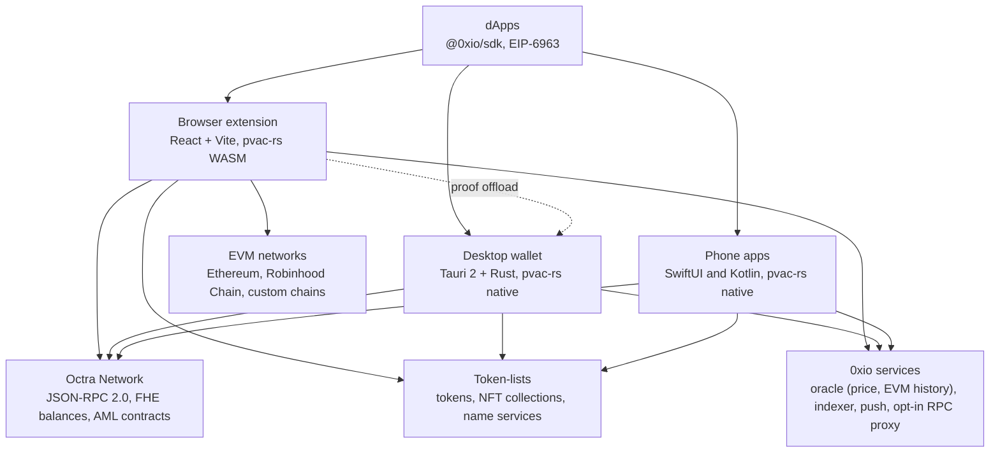

# 0xio

Privacy-first wallets for the Octra Network, built by **0xio Labs**.

**Install any 0xio client: [0xio.xyz/install](https://0xio.xyz/install)**

0xio is a browser extension, a desktop app, phone apps and developer tools on one privacy stack: fully homomorphic encryption (FHE) for balances and transfers whose amounts stay encrypted on chain. The extension also holds an EVM wallet on the same recovery phrase.

## Products

| Product | Status | Get it |
|---------|--------|--------|
| Browser extension | Live, v3.0.6 (Chrome Web Store; Firefox pending). Open source (GPL-3.0-only) | [0xio.xyz/install](https://0xio.xyz/install), source: [0xio-wallet](https://github.com/0xio-xyz/0xio-wallet) |
| Desktop wallet | Live, v0.7.3 (macOS on Apple silicon and Intel, Windows; signed and notarized) | [0xio.xyz/install](https://0xio.xyz/install) |
| Phone apps | Native apps v2.0.0: Android on Google Play, iOS on TestFlight | [0xio.xyz/install](https://0xio.xyz/install) |
| Developer SDK | `@0xio/sdk` v2.12.2 | [npm](https://www.npmjs.com/package/@0xio/sdk) |
| PVAC SDK | `@0xio/pvac` v1.0.1 | [npm](https://www.npmjs.com/package/@0xio/pvac) |
| 0xio Bridge | Offline for now. OCT and wOCT (Ethereum), any chain to OCT | [bridge.0xio.xyz](https://bridge.0xio.xyz) |
| 0xio DEX | Offline for now | [dex.0xio.xyz](https://dex.0xio.xyz) |
| 0xio Oracle | Live, OCT/USD from the wOCT/ETH Uniswap v4 pool and live ETH/USD | oracle.0xio.xyz |
| Token lists | Tokens, NFT collections and name services, read by every client | [Token-lists](https://github.com/0xio-xyz/Token-lists) |
| Telegram bot | Live, wallet monitoring | [@NullXio_bot](https://t.me/NullXio_bot) |

### Browser extension

React and Vite, Manifest V3, with a separate Firefox build. Privacy operations run in the browser through pvac-rs compiled to WebAssembly.

The extension is open source under GPL-3.0-only at [0xio-wallet](https://github.com/0xio-xyz/0xio-wallet). Its runtime code depends on ten well-known packages (signing, hashing, key derivation and React); the rest, from the QR code to the router, is written in the repository. The README covers building it yourself, and SECURITY.md covers reporting a vulnerability.

- Private balances: encrypt, decrypt, private sends and claims, with a claim budget that keeps every balance within its recoverable layer limit
- EVM wallet: one recovery phrase makes the Octra address and one 0x address. Ethereum and Robinhood Chain are built in, with custom EVM networks and ERC-20 import
- One history for Octra and EVM, sorted by time
- The bridge inside the wallet: OCT to wOCT, wOCT to OCT, and any chain to OCT, each step with its own review
- For websites: Octra through `@0xio/sdk`, EVM through EIP-6963, with a review before every signature, transaction and contract deploy
- Sites bound to the wallet they connected with; network switches requested by a site need approval
- Vault: AES-GCM under a random vault key wrapped by the password (PBKDF2, 900,000 iterations); optional passkey unlock
- Tokens and NFT collections, with transfers named in history
- Your own node as a network; the 0xio RPC proxy is opt-in and never a fallback
- Heavy proofs offload to a paired 0xio Desktop
- English, Indonesian, Chinese, Japanese and Korean

### Desktop wallet

Tauri 2 with a Rust backend and a React front end. pvac-rs runs natively, which makes it the fastest place to build privacy proofs, and it can do them for the extension on the same machine.

- Full wallet: create, import, send, receive, private balance, claims, NFTs
- Keys stay in Rust: the private key and recovery phrase never reach the page
- Menu bar panel on macOS: balance, send and receive, encrypt and decrypt, claims and a command line, with a review before anything is signed
- Circles: publish files or a whole folder, sealed circles, and a built-in browser for `oct://` addresses and dApps
- Octra names on devnet: send to `0xio.oct`, open a Circle by name
- Contracts: deploy, call, call-view and verification, with FHE parameters
- Sites in any browser can use the desktop wallet through the extension
- Touch ID and Windows Hello
- Signed updates (minisign), served through 0xio.xyz

### Phone apps

The apps are native: SwiftUI on iOS, Kotlin and Jetpack Compose on Android, each with the wallet logic in its own library checked against shared test vectors. pvac-rs ships as a native library on both.

- PIN and biometric unlock
- Every send, signature and connection confirmed with a slide before anything is signed
- Private balance with the same rules as the extension and desktop
- dApp browser, Circles and WalletConnect
- NFT gallery, address book, QR send and receive
- Octra names on devnet
- Five languages

### Developer SDK

`@0xio/sdk` connects dApps to any 0xio wallet: connection, public and private transactions, balances, message signing, contract calls and deploys, finality tracking and typed events. Framework agnostic, full TypeScript types.

```bash
npm install @0xio/sdk
```

```typescript
import { ZeroXIOWallet } from '@0xio/sdk';

const wallet = new ZeroXIOWallet({ appName: 'My DApp' });
await wallet.initialize();
const { address } = await wallet.connect();

const name = await wallet.lookupAddress(); // '0xio.oct' or null
```

Since 2.12.2, `lookupAddress` and `resolveName` read the Octra Name System, so a dApp can show a `.oct` name for the connected wallet.

`@0xio/pvac` ships the privacy primitives on their own (FHE encrypt and decrypt, range and bound proofs, cipher arithmetic, Pedersen commitments) as WASM that runs entirely client-side.

## Security and cryptography

### Keys

- **Mnemonic:** BIP39, 128-bit entropy, 12 words.
- **Seed:** PBKDF2 with HMAC-SHA512, 2,048 iterations.
- **Master key:** `HMAC-SHA512("Octra seed", seed)[0:32]`, the same on every platform.
- **Signing:** Ed25519.
- **Address:** SHA-256 of the public key, Base58, `oct` prefix, 47 characters.
- **EVM (extension):** secp256k1 key on the standard path `m/44'/60'/0'/0/i` from the same phrase. The key is derived for each signature, checked against the wallet's 0x address and wiped after. Private key wallets have no EVM address.

### Privacy (PVAC)

PVAC is 0xio's privacy system on fully homomorphic encryption: encrypted balances that the chain can add without decrypting.

- **FHE encrypt and decrypt** of amounts
- **Range proofs** (64-bit) that an encrypted amount is valid without revealing it
- **Pedersen commitments** for transaction integrity
- **Stealth transfers:** ECDH one-time addresses the recipient finds by scanning
- **Zero proofs** for decrypting back to a public balance

`pvac-rs` implements all of it in Rust (curve25519-dalek, multithreaded proofs and decrypts) and compiles to WASM, iOS, Android and native desktop.

### Every transaction is reviewed

Every transaction, approvals included, shows a review of exactly what gets signed. Face ID, Touch ID or a PIN is an extra check, never the only one. A send whose result is unclear never offers a resend.

### Storage

- **Extension:** AES-GCM vault under a password-wrapped random vault key (PBKDF2, 900,000 iterations).
- **Desktop:** AES-256-GCM vault file (PBKDF2, 600,000 iterations), keys held in Rust and zeroed on lock.
- **Phone:** keys in the iOS Keychain or Android Keystore, PIN checked against a PBKDF2 hash, biometrics for unlock.

### Contract addresses

No client builds in a contract address that can change. Tokens, NFT collections and the name service are read from [Token-lists](https://github.com/0xio-xyz/Token-lists), validated, checked on chain before use, and the last good copy is kept for when the list cannot be reached.

## Architecture



## Repositories

| Repository | What it is | Status |
|------------|------------|--------|
| **0xio-wallet** | Browser extension, open source (GPL-3.0-only) | Live (3.0.6) |
| **0xio-desktop** | Desktop wallet (Tauri + Rust) | Live (0.7.3) |
| **0xio-app-ios** | iPhone app (SwiftUI) | TestFlight (2.0.0) |
| **0xio-app-android** | Android app (Kotlin, Compose) | Google Play (2.0.0) |
| **0xio-app** | Previous phone app (React Native), replaced by the native apps | Kept for older Android devices (1.3.3) |
| **0xio-sdk** | `@0xio/sdk` | Public, on npm (2.12.2) |
| **0xio-pvac** | `@0xio/pvac` | Public, on npm |
| **pvac-rs** | Privacy library (Rust) | Used by every client |
| **Token-lists** | Tokens, NFT collections, name services and logos | Public |
| **ecosystem** | Projects listed at 0xio.xyz/ecosystem | Public |
| **documentation** | Docs site | Public, live at docs.0xio.xyz |
| **Recovery-tools** | Recover an Octra address and key from a recovery phrase | Public |
| **0xio-eco-one** | Website, install page and desktop update feed | Live at 0xio.xyz |
| **dev-portal** | Developer accounts and API keys | Live |
| **0xio-bridge** | OCT and wOCT bridge | Offline for now |
| **0xio-dex** | Exchange | Offline for now |
| **0xio-solver** | Swap solver for the earlier cross-chain DEX | Offline |
| **0xio-oracle** | Price oracle and EVM history (Rust) | Live |
| **0xio-indexer** | Chain indexer | Live |
| **0xio-rpc-proxy** | Caching RPC proxy, opt-in | Live |
| **0xio-push-server** | Push notifications | Live |
| **0xio-bot** | Telegram bot | Live |

## Roadmap

Shipped:

- Browser extension on the Chrome Web Store with full FHE privacy and an EVM wallet
- Bridge inside the extension (OCT and wOCT, any chain to OCT)
- Desktop wallet for macOS and Windows with native proofs and signed updates
- Native Android app on Google Play and native iOS app on TestFlight
- Browser extension open source under GPL-3.0-only
- `@0xio/sdk` and `@0xio/pvac` on npm
- One install page for every client at 0xio.xyz/install
- Octra names in every wallet and in the SDK (devnet)

Next:

- Native iOS app on the App Store
- Extension on Mozilla Add-ons (pending)
- Bridge and DEX sites back online
- Octra names on mainnet when the name service launches there
- 0xio DEX

## Getting started

**Users:** install any client from [0xio.xyz/install](https://0xio.xyz/install), create a wallet or import your 12-word recovery phrase, and you are on the Octra Network.

**Developers:** `npm install @0xio/sdk`, then see the [SDK guide](https://docs.0xio.xyz/developers/sdk-guide).

## Community and support

- **Website:** [0xio.xyz](https://0xio.xyz)
- **Install:** [0xio.xyz/install](https://0xio.xyz/install)
- **Documentation:** [docs.0xio.xyz](https://docs.0xio.xyz)
- **X:** [@0xio_xyz](https://x.com/0xio_xyz)
- **GitHub:** [@0xio-xyz](https://github.com/0xio-xyz/)
- **Telegram:** [@Nullxgery](https://t.me/nullXgery)
- **Email:** team@0xio.xyz

## License

The **0xio browser extension** ([0xio-wallet](https://github.com/0xio-xyz/0xio-wallet)) is open source under the GNU General Public License v3.0 only (GPL-3.0-only).

**`@0xio/sdk`** ([0xio-sdk](https://github.com/0xio-xyz/0xio-sdk)) and [Token-lists](https://github.com/0xio-xyz/Token-lists) are open source under the MIT License.

**0xio Desktop and the phone apps** are proprietary software. Copyright &copy; 2026 0xio Labs. All rights reserved. Unauthorized copying, modification, distribution or use is prohibited.

The **legacy 0xio extension** ([Legacy](https://github.com/0xio-xyz/Legacy)) remains open source under the MIT License for educational purposes.

---

**0xio** is developed and maintained by **0xio Labs**. It is built for the **Octra Network**, but 0xio Labs is an independent company and is not affiliated with Octra Labs. This software is provided "as is", without warranty of any kind. You are responsible for the security of your recovery phrases and private keys.
